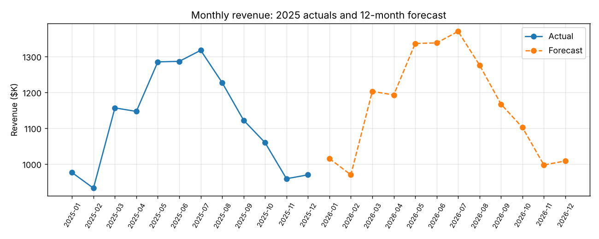

# Retail & Manufacturing Financial Intelligence Suite


Financial reporting and analysis for a business with three Salt Lake-area retail stores and a West Valley City manufacturing hub, built on a year of synthetic ERP data. It produces a location-level P&L, reconciles the sales system to the general ledger, measures inventory efficiency by product, and forecasts next year's revenue.



## What it produces

| View | What it answers |
|---|---|
| **P&L by location and month** | Revenue, COGS, gross margin, operating expenses and operating margin, built from the GL |
| **GL reconciliation** | Do revenue and COGS posted to the GL match the sales subledger, by month and location? Differences over $1 are flagged as breaks. |
| **Inventory metrics** | Inventory turnover, days on hand, gross margin %, and GMROI (gross margin dollars per dollar of average inventory) by product, with slow movers flagged |
| **12-month revenue forecast** | Each month of next year based on the same month this year, grown by a stated assumption (4% by default) |

All views are written to `output/financial_intelligence.xlsx`, one sheet each, ready to open in Excel or import into Power BI. Charts are written to `output/`.

## Results from the sample year

- **$13.4M revenue, 45.2% gross margin, 24.2% operating margin.** The manufacturing hub produces about a third of revenue at a slightly higher operating margin.
- **One reconciliation break:** June revenue at Murray-Retail is $4,850 lower in the GL than in the sales system. In practice that means a missed or reversed posting to investigate before close.
- **Custom-Part-X is the slow mover:** about 78 days on hand against 31–35 for the other products, and the lowest GMROI (2.6). It's the first candidate for lower stocking levels.
- **Forecast:** $14.0M for 2026 at 4% growth, keeping the summer peak.

## Run it

```bash
pip install -r requirements.txt
python src/generate_data.py   # optional: regenerate the sample data
python src/analysis.py
pytest -q
```

**Data** (`data/`)
- `erp_sales_data.csv`: about 5,800 daily sales lines (location, product, units, price, unit cost, revenue, cost, margin), with seasonality and weekend effects
- `inventory.csv`: month-end units and cost on hand by product
- `gl_entries.csv`: monthly revenue, COGS and operating expense postings by location, including one planted posting error

## Forecast method

With only one year of history, fitting a trend line mistakes seasonality for growth (the year ends in the slow winter months). So the forecast takes each month's actual revenue and applies an explicit growth assumption, `GROWTH_ASSUMPTION` in `src/analysis.py`. With two or more years of data, a trend-plus-seasonality model would be the next step.

## Tests

The tests check that the P&L ties (gross profit and operating income, and location totals to the company total), that the reconciliation finds exactly the planted break, the turnover and days-on-hand relationship and the slow-mover flag, and the forecast arithmetic.

## License

MIT
